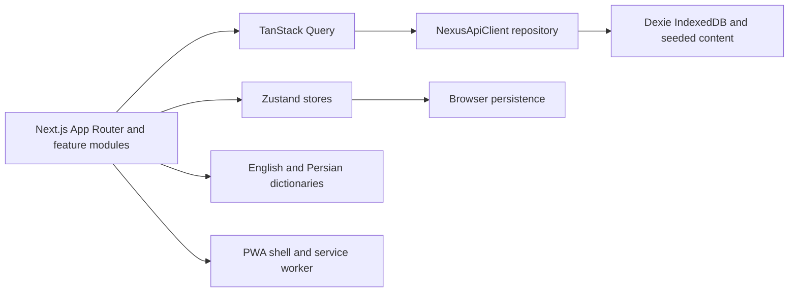

<div align="center">

# NEXUS STREAM

### A personal signal console for the next era of video

A bilingual, installable video discovery experience that puts recommendation controls, contextual playback, and creator tools in the viewer’s hands.


</div>

---

## Product overview

NEXUS STREAM is an interactive streaming frontend built around an unusual premise: the viewer should be able to tune the discovery algorithm rather than simply accept it. Its neon-on-carbon interface pairs a tactile three-axis equalizer with an adaptive feed, a high-context watch experience, and a set of social and creator destinations. English and Persian are first-class locales, including right-to-left layout support.

The repository ships with a typed local data layer and seeded content so the full frontend can be explored without a remote account or service. The repository boundary is designed to let the local adapter evolve into a production API without changing the application’s feature contracts.

## Highlights

- **Viewer-controlled discovery:** adjust novelty, technical depth, and hype; switch to chronological delivery; reset the mix at any time.
- **Context-rich playback:** emotional timeline markers, transcript search and scrubbing, time-anchored discussion, and playback controls.
- **A connected product surface:** home, vertical discovery, dimension view, live lounge, player profile, and creator studio routes.
- **Bilingual shell:** English and Persian dictionaries with persisted locale selection and automatic LTR/RTL document direction.
- **Offline-minded foundation:** installable PWA shell, local IndexedDB seed content, and persisted client preferences.
- **Accessible interactions:** semantic controls, labeled sliders and switches, keyboard-operable comment tabs, reduced-motion support, and responsive layouts.

## Experience map

| Route | Experience |
| :--- | :--- |
| `/` | Adaptive video matrix and Algorithm Equalizer |
| `/watch/[id]` | Player, emotional timeline, transcript tools, and categorized comments |
| `/dimension` | Vertical Hyper-Feed |
| `/lounge/[roomId]` | Cyber-Lounge room |
| `/profile/[handle]` | Player identity, watch DNA, and trophies |
| `/studio` | Creator Studio workspace |

## Architecture



The UI depends on a small repository adapter rather than on the database directly. Query state handles asynchronous reads and caching; Zustand owns user preferences and playback state; Dexie provides the current local persistence layer. Domain contracts in `src/types/schema.ts` are shared across these boundaries.

## Technology

- **Application:** Next.js 15 App Router, React 19, TypeScript 5.9 (strict mode)
- **Styling:** Tailwind CSS v4 and a custom token-driven Cyber-HUD design system
- **State and data:** Zustand, TanStack Query, Dexie / IndexedDB
- **Interaction:** Framer Motion and Lucide React
- **Quality:** Vitest, Testing Library, Playwright, GitHub Actions
- **Typography:** Space Grotesk, JetBrains Mono, and Inter variable fonts

## Local development

### Requirements

- Node.js `>=20.9.0`
- pnpm 10+

```bash
pnpm install
pnpm dev
```

Open [http://localhost:3000](http://localhost:3000). The local database is initialized with bundled sample records on first use.

### Quality checks

```bash
pnpm typecheck
pnpm test
pnpm exec playwright install chromium  # first run only
pnpm test:e2e
pnpm build
```

Playwright starts the Next.js development server automatically when needed. CI installs Chromium with its system dependencies before running the browser suite.

## Design system

Design tokens live in `src/app/globals.css`.

| Token | Value | Role |
| :--- | :--- | :--- |
| `--bg-void` | `#07080D` | Carbon-matte base surface |
| `--bg-hud` | `rgba(14, 17, 26, 0.78)` | Translucent glass panels |
| `--bg-elevated` | `#131722` | Cards and elevated modules |
| `--neon-primary` | `#00F0FF` | Primary signal accent |
| `--neon-secondary` | `#BC13FE` | Secondary accent |
| `--neon-success` | `#00FF66` | Healthy telemetry |
| `--neon-warning` | `#FFB800` | Highlights and caution |
| `--neon-danger` | `#FF0055` | Live status and destructive actions |

## Project structure

```text
src/
├── app/              # Routes, layout, global styling, and providers
├── components/       # Shared interface and application shell
├── features/         # Home, player, equalizer, comments, and product modules
├── hooks/            # Locale, PWA, and interaction hooks
├── lib/              # Localization, formatting, and browser utilities
├── services/         # IndexedDB and repository adapter
├── stores/           # User preferences, player, and queue state
└── types/            # Domain and UI contracts
tests/e2e/             # Playwright browser coverage
```

## Data and service boundary

The app currently runs against local seeded content; the sample media and records are for demonstration. `NexusApiClient` is the feature-facing repository boundary and can be backed by a remote service when one is available. Authentication, server-side persistence, and production media delivery are intentionally separate integration concerns rather than hidden assumptions in the frontend.

## License

No open-source license has been specified for this repository. Contact the project owner before reuse or redistribution.
